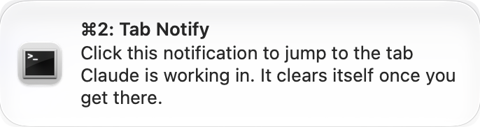

# claude-code-tab-notify

macOS notifications for Claude Code (and Codex) that take you to the right terminal tab when you click them.

When you run Claude Code in several tabs, it's hard to tell which one needs you. This tool posts a notification every time Claude finishes or asks for something. The notification says which tab it came from, clicking it switches to that exact tab, and it disappears once you've dealt with it.




- **Title:** the tab's name. `⌘2:` means you can also press ⌘2 in that terminal window to get there.
- **Message:** the start of Claude's reply, or what Claude is asking for.
- **Click:** switches to that tab, even if it's in another window.

## What you need

- A Mac.
- [Homebrew](https://brew.sh), to install one small tool.
- Claude Code, Codex, or both.
- One of these terminals: iTerm2, Terminal (the one built into macOS), Ghostty or Warp. See [Which terminals work](#which-terminals-work) for how well each one works.

## Install

**1. Install terminal-notifier**, the small app that shows the notifications:

```bash
brew install terminal-notifier
```

**2. Download this tool.** Put it somewhere permanent, because your hooks will run it from that folder:

```bash
git clone https://github.com/zackkatz/claude-code-tab-notify.git
cd claude-code-tab-notify
```

**3. Run the installer:**

```bash
./install.sh
```

The installer adds three hooks to `~/.claude/settings.json`. A hook is a command Claude Code runs at certain moments, such as when it finishes a reply. Your existing settings stay as they are, and the installer saves a backup first (`settings.json.bak-cctn-<date>`). Running it twice changes nothing the second time.

If you use Codex, the installer adds its hooks too. Open Codex, type `/hooks`, and trust the two `claude-code-tab-notify` entries. Codex won't run them until you do.

**4. Restart Claude Code** in each open tab, so it picks up the new hooks.

**5. Check that everything is in place:**

```bash
bin/claude-code-tab-notify doctor
```

`doctor` checks that terminal-notifier is installed, that the hooks are registered, and that this tab can be found. Fix anything it marks as a problem.

**6. Try it.** Ask Claude something in one tab, switch to another tab, and wait for the reply. A notification should appear. Click it, and you're back in the first tab.

The first time, macOS may ask two things:
- Whether **terminal-notifier** may show notifications. Allow it.
- Whether it may **control iTerm2** (or Terminal). Allow it, or clicking can't switch tabs.

## Make notifications stay on screen

By default, macOS hides a notification after a few seconds. To keep each one up until you click or close it:

1. In **System Settings**, open **Notifications**, then **terminal-notifier**.
2. Set **Alert style** to **Alerts**.

To have them go away on their own after a while instead, use the `expire_after` [setting](#settings).

If you see two terminal-notifier entries, change the one `doctor` marks as the Homebrew build. The other comes from a copy bundled inside an npm package (`node-notifier`).

## Clear notifications when you switch tabs (optional)

A notification normally clears when you click it, or when you type in its tab. To clear it the moment you switch to its tab, run the small background watcher. Run these from the `claude-code-tab-notify` folder.

**1. Copy the watcher's settings file into place,** with the path pointing at your copy of this tool:

```bash
sed "s#/Users/zackkatz/Local/dev/claude-code-tab-notify#$PWD#" \
  launchd/com.zackkatz.claude-code-tab-notify.watch.plist \
  > ~/Library/LaunchAgents/com.zackkatz.claude-code-tab-notify.watch.plist
```

**2. Start it.** It also starts by itself every time you log in:

```bash
launchctl load -w ~/Library/LaunchAgents/com.zackkatz.claude-code-tab-notify.watch.plist
```

**3. When macOS asks** whether it may control iTerm2 (or Terminal), allow it. Until you do, the watcher runs but clears nothing.

To stop it:

```bash
launchctl unload -w ~/Library/LaunchAgents/com.zackkatz.claude-code-tab-notify.watch.plist
```

The watcher checks about once a second and costs almost nothing. It only asks your terminal which tab is in front while a notification is waiting. It works with iTerm2 and Terminal only, because Ghostty and Warp can't report which tab is in front.

No notification is sent for the tab you're looking at, unless you've stepped away. A notification for the tab in front stays until you leave that tab and come back. Switching to a tab clears its notification after you've stayed there 2 seconds. To control how clearing works, see the `clear_on_switch` and `clear_delay` [settings](#settings).

## Which terminals work

| Terminal | Clicking takes you to | ⌘ number in the title | Watcher clears on tab switch |
| --- | --- | --- | --- |
| iTerm2 | the exact tab and split pane | yes | yes |
| Terminal | the exact tab | yes | yes |
| Ghostty | the tab, if it's the only one open in that folder | yes | no |
| Warp | the session's window and tab | no | no |
| VS Code or another terminal | that app (no particular tab) | no | no |

**Ghostty** can only be matched by folder. If two Ghostty tabs are open in the same folder, the tool can't tell them apart, so clicking does nothing rather than risk the wrong tab.

**Warp** can't be controlled by scripts, but since 2026 every Warp tab has its own link that brings it to the front, and clicking uses that link. Warp can't share a tab's name or position, so the title shows the Claude Code session's name instead (see below), with no ⌘ number. Warp hasn't documented this link yet, so a Warp update could break it.

## What the notification shows

**The title** is the first of these the tool can find:

1. **The tab's name**, starting with its keyboard shortcut. Tabs 1 to 9 get `⌘1:` to `⌘9:`. In iTerm2, ⌘9 always means the last tab, so tabs 1 to 8 get `⌘1:` to `⌘8:`, the last tab gets `⌘9:`, and any other tab gets `Tab 12:` (its position) instead. The spinning status symbol and the "(claude)" at the end of Claude Code's tab names are removed.
2. **The session's name**: the one you gave it with `/rename`, or else the one Claude Code made up for it.
3. **"Claude Code (folder): Task Complete"** (or "Input Required").

**The message** is the start of Claude's last reply, up to about 150 characters, cut at a word. Formatting such as bold text, code and links is removed. A short opening line such as "Done." is skipped. When Claude needs permission or input, the message says what it's waiting for.

Each tab keeps only its latest notification. A new one replaces the old one instead of piling up.

No notification is sent while you're looking at that session's tab, since you can already see the reply. If you've stepped away (no keyboard or mouse use for a minute), it's sent anyway, so the sound can call you back. Change this with the `notify_when_focused` and `away_after` [settings](#settings).

Claude Code's "Claude is waiting for your input" reminder is skipped, so it doesn't replace the notification that shows Claude's reply. Turn it on with `notify_on_idle`.

## Settings

See every setting and its current value:

```bash
bin/claude-code-tab-notify config
```

Change one:

```bash
bin/claude-code-tab-notify config set clear_delay 3
```

Put one back to its default:

```bash
bin/claude-code-tab-notify config unset clear_delay
```

Changes apply to the next notification. The watcher notices a change within a second, with no restart.

| Setting | What it does | Default |
| --- | --- | --- |
| `notify_on_done` | Notify when Claude finishes a reply | `1` (on) |
| `notify_on_input` | Notify when Claude needs permission or input | `1` (on) |
| `notify_on_idle` | Notify for Claude Code's "Claude is waiting for your input" reminder, sent about a minute after a reply. Off by default, because it would replace the notification that shows the reply | `0` (off) |
| `notify_when_focused` | Notify even when the session's tab is the one in front. Off by default, since you can already see it. Works in iTerm2 and Terminal; Ghostty and Warp tabs always notify | `0` (off) |
| `away_after` | When you haven't used the keyboard or mouse for this many seconds, the tab in front gets a notification too, so a finished task still calls you back. `0` never notifies for the tab in front | `60` |
| `sound_done` | Sound when Claude finishes. Any name from `/System/Library/Sounds`, such as `Ping`, or `none` | `Blow` |
| `sound_input` | Sound when Claude needs you | `Glass` |
| `clear_on_type` | Clear a tab's notification when you type in that tab | `1` (on) |
| `clear_on_switch` | Clear a notification when you switch to its tab. Needs the [watcher](#clear-notifications-when-you-switch-tabs-optional) | `1` (on) |
| `clear_delay` | Seconds you must stay on a tab before switching to it clears its notification, so flipping through tabs doesn't clear ones you never read. `0` clears at once | `2` |
| `expire_after` | Seconds before a notification removes itself, even if you never look. `0` keeps it until it's cleared | `0` |
| `banner_chars` | Most characters of Claude's reply to show | `150` |
| `title_prefix` | Text before every title, for example `CC: `, to tell these apart from other notifications | none |
| `always_notify` | Notify even for sessions that can't be matched to a tab (see [Background sessions](#background-sessions)) | `0` (off) |

For on/off settings, `1`, `yes`, `true` and `on` all mean on. Anything else means off.

**Staying on screen** isn't a setting here, because macOS decides it for each app. See [Make notifications stay on screen](#make-notifications-stay-on-screen). To have notifications stay up but still go away on their own, set the alert style to Alerts and set `expire_after`.

The settings are saved in `~/.config/claude-code-tab-notify/config`. The first `config set` creates it with every setting listed, each turned off with a `#` in front and explained in a comment above it:

```
# Seconds to stay on a tab before switching to it clears its notification
# CCTN_CLEAR_DELAY="0"
```

To edit it by hand, remove the `# ` in front of a setting and change its value. `config set` and `config unset` change only that setting's line, so your own comments stay. An environment variable with the same name (`CCTN_CLEAR_DELAY`) wins over the file, which is handy for a one-off test.

## Troubleshooting

**No notifications at all.**
Run `bin/claude-code-tab-notify doctor`. Then check that Focus or Do Not Disturb is off, and that notifications are allowed for terminal-notifier (**System Settings**, then **Notifications**). Remember to restart Claude Code after installing.

**Clicking a notification does nothing.**
macOS probably blocked the tool from controlling your terminal. In **System Settings**, open **Privacy & Security**, then **Automation**, and allow terminal-notifier to control iTerm2 or Terminal. In Ghostty, it can also mean two tabs are open in the same folder.

**Notifications don't clear when I switch tabs.**
That needs the [watcher](#clear-notifications-when-you-switch-tabs-optional), and it only works in iTerm2 and Terminal. If it's running but nothing clears, look in its log: `cat /tmp/cctn-watch.log`.

**The title says "Claude Code (folder)" instead of the tab name.**
The tab couldn't be found, usually because the terminal answered too slowly or doesn't support it. Run `doctor` from that tab to see what it finds.

**I want to see what happened.**
Every notification is written to a log, one line each:

```bash
tail -20 "$TMPDIR/cctn.log"
```

## Background sessions

Claude Code background sessions don't run in a tab, so there's no tab to switch to. Their notifications say `background job: <name>` so you can tell which job finished.

If you've installed iTerm2's own Claude Code integration, notifications that can't be matched to a tab are skipped, because iTerm2 already posts one for those sessions. Set `CCTN_ALWAYS_NOTIFY=1` to get them anyway.

## Codex

The installer sets up Codex too if it finds `~/.codex` (or `$CODEX_HOME`). Remember to trust the hooks with `/hooks` in Codex. Codex notifications show the start of Codex's reply, the same as Claude Code's.

Codex runs its hooks from one shared background process, so finding the tab works differently. The tool looks up the conversation's name and finds the iTerm2 tab with that name. This only works in iTerm2, and only once the conversation has a name.

## Uninstall

```bash
./uninstall.sh
```

This removes only the hooks this tool added, from both Claude Code and Codex, and saves a backup first. If you started the watcher, stop it with the `launchctl unload` command above and delete `~/Library/LaunchAgents/com.zackkatz.claude-code-tab-notify.watch.plist`.

## How it works

The whole tool is one bash script, `bin/claude-code-tab-notify`. The installer connects it to three Claude Code hooks:

| When | Hook | What the script does |
| --- | --- | --- |
| Claude finishes a reply | `Stop` | posts a notification |
| Claude needs permission or input | `Notification` | posts a notification |
| You type in the tab | `UserPromptSubmit` | clears that tab's notification |

To find the tab, the script asks each running terminal (through AppleScript) whether it owns this session, matching on the session's ID or its terminal device. The notification stores a small command, and clicking runs it to select that tab and clear the notification.

Architecture, internals and the pitfalls found along the way are in [AGENTS.md](AGENTS.md).

## Tests

```bash
./test/run.sh
```

The tests never post real notifications, and they keep their temporary files separate from yours. Tests that need a particular terminal running are skipped when it isn't.

## Credits

The `stop_hook_active` guard and the idea of showing the tab's title in the notification came from [stevemeisner/claude-iterm-notify](https://github.com/stevemeisner/claude-iterm-notify), which is MIT licensed.

## License

MIT
